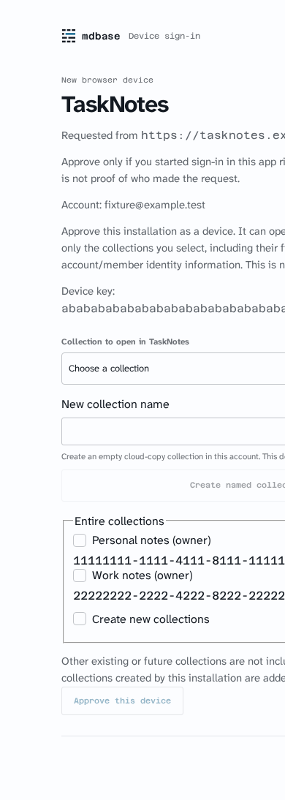
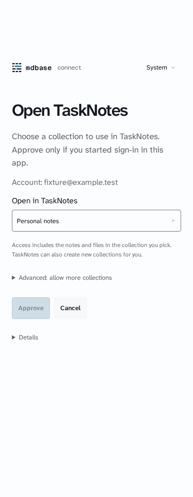
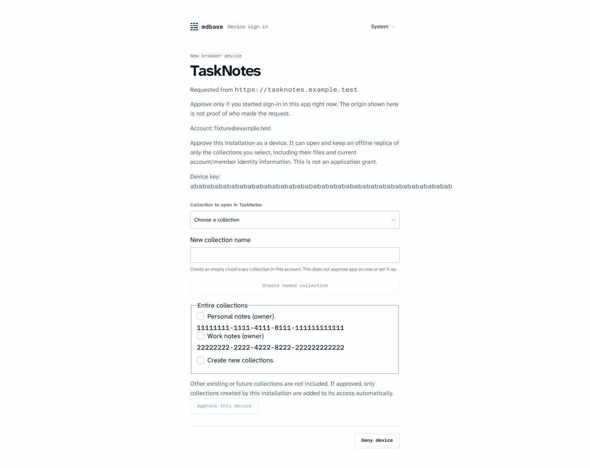
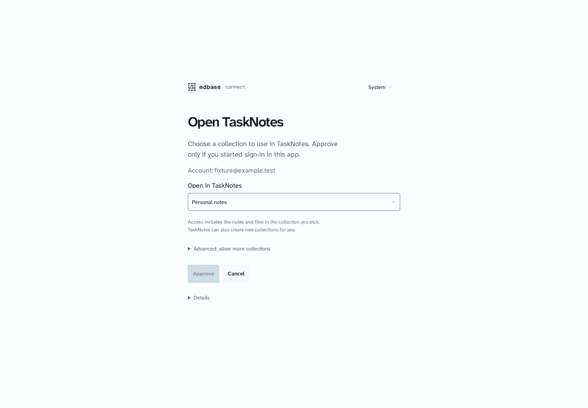

# Device collection approval

Synthetic TaskNotes request, Personal notes and Work notes; no real account or device data. Captured with an isolated headless browser against a local production portal build. Browser/server were closed after each run.

The same request and viewport settings are used before and after. The old 390px page overflowed horizontally; its image is cropped to the actual 390px viewport. Desktop is 1440px.

| Viewport | Before | After |
| --- | --- | --- |
| 390px |  |  |
| Desktop |  |  |

One primary collection picker replaces the picker plus separate collection checklist. New collection naming is inline; Approve creates using the existing original request/name endpoint before approving that exact collection. Additional access and technical detail are collapsed. Server routes, account confirmation, membership checks, per-collection scope, original creation provenance and retained access are unchanged.

The registered portal browser audit checks exact default/advanced/additive consent payloads, no visible UUIDs, GitHub no-email display, lost creation/approval replies without automatic mutation replay, light/dark 320/390/1440 layouts, 200% reflow and 44px actions. This is synthetic UI evidence, not native caller acceptance.
