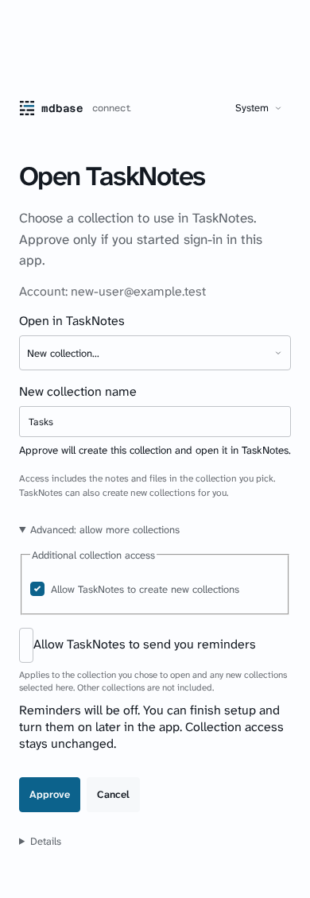
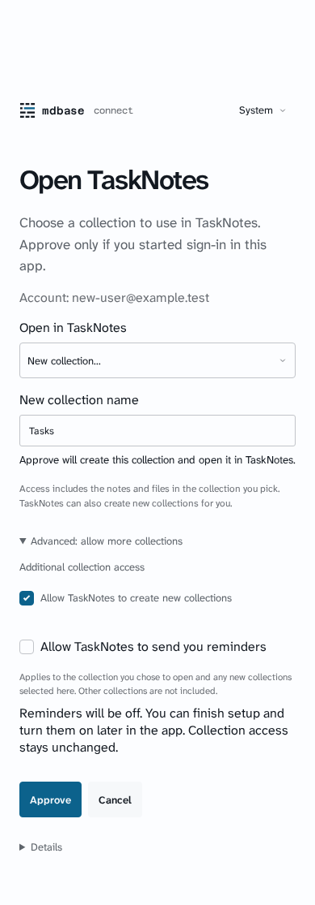
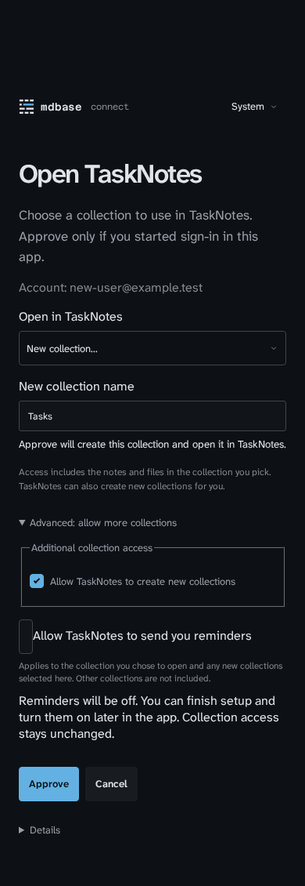
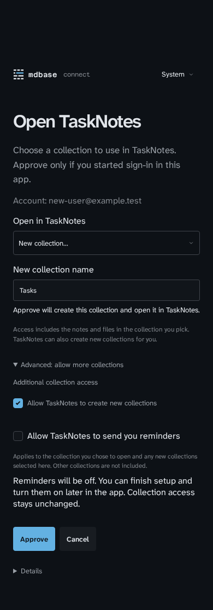
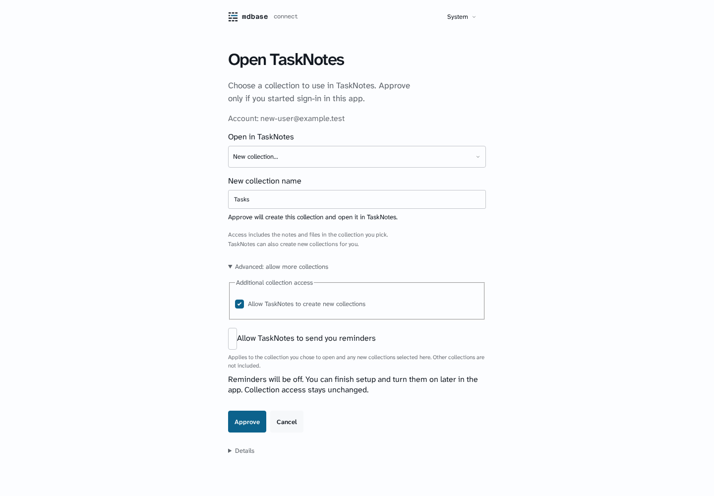
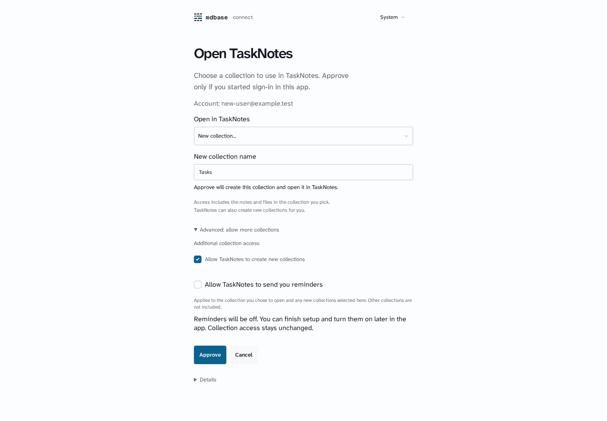
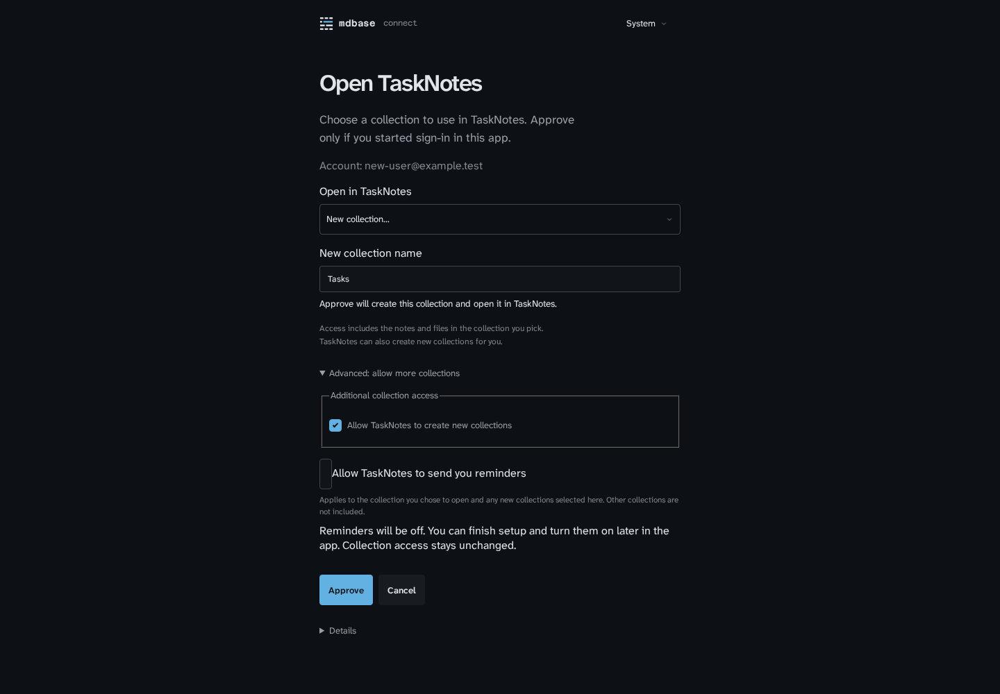
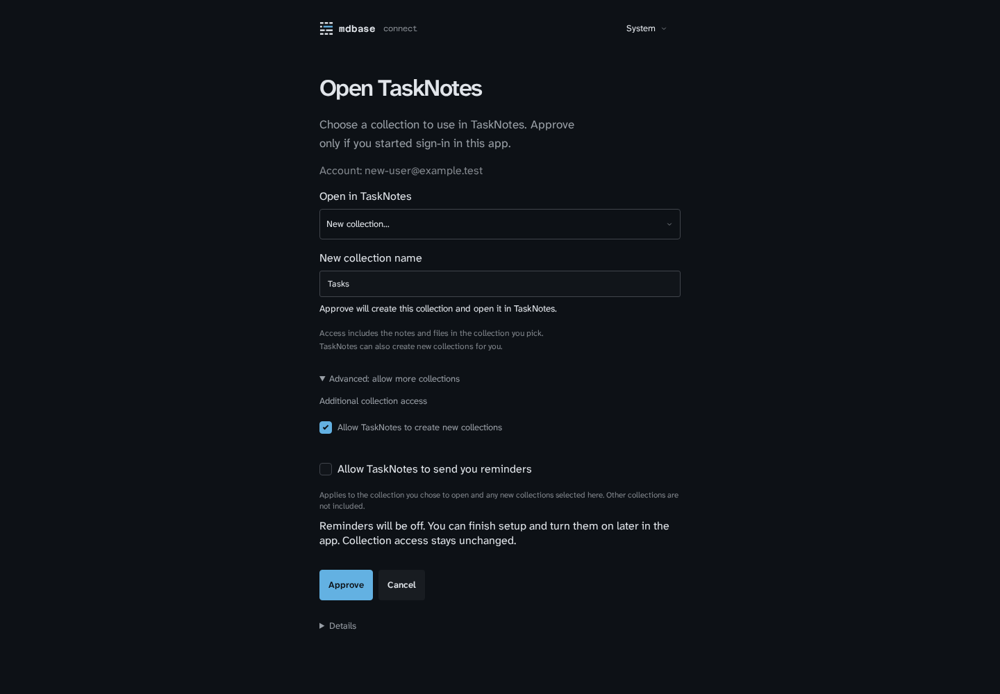

# Installation approval controls

Synthetic first-run TaskNotes request for an account with no collections, "New collection…" chosen and Advanced open. No real account or device data. Captured with an isolated headless browser against a local production portal build.

| Viewport | Before | After |
| --- | --- | --- |
| 390px light |  |  |
| 390px dark |  |  |
| Desktop light |  |  |
| Desktop dark |  |  |

The consent checkboxes now use the shared `Checkbox` and `CheckboxGroup` from `@mdbase-dev/ui/checkbox`. The additional-access group no longer draws the browser's fieldset outline, and the reminders checkbox keeps its 18px size with the 44px target on its label. When there is nothing extra to allow, the Advanced section is not shown.
